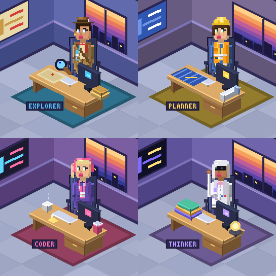

# Agent Office

A pixel-art office in a pane next to your Claude Code chat. Every running subagent gets its own square portrait, at its desk, with a line underneath saying what it is doing right now, like `reading login.ts` or `running tests`.



## Install

In a Claude Code session, type:

```
/plugin install agent-office --marketplace mathiasolofsson87/Claude-agents-office
```

Answer `y` to add the marketplace, then pick a scope. The plugin is active straight away.

## Use

Type `/office` to open the pane, or just start a subagent: the pane opens by itself the first time.

| Command | What it does |
| --- | --- |
| `/office` | Opens the pane. |
| `/office demo` | Staffs the office with demo agents (`/office demo 12` for twelve, up to 16), so you can see it without real subagents. |
| `/office clear` | Sends everyone home. |
| `/office auto` | The default: portraits where the terminal can draw them, a text list everywhere else. |
| `/office image` | Always portraits, even if this terminal cannot draw them (you would then see only a placeholder). |
| `/office text` | Always the text list, the lightest option. |
| `/office info` | What the plugin sees: which terminal, whether it can draw pictures, and the pane's size. Useful when something looks wrong. |
| `/office stats` | How many pictures were drawn and how often the pane redrew. |

Close the pane with its close mark; closing it stops all of the plugin's work.

## What you see

When a subagent starts, a new tile appears: its portrait, its role, and its current task. The portrait shows the agent at their desk in a small office, with a window and a picture on the wall in the role's colours. Tiles sit two across and the grid grows downward as agents are added. One agent shows as one tile. When an agent finishes, its tile says `done` for a few seconds and then goes, and the grid closes up. Up to 16 tiles are drawn; beyond that the pane says how many more are working.

Each agent becomes a character, chosen from its subagent type and description:

| Character | Subagents |
| --- | --- |
| Explorer, with a fedora | Explore, or anything about finding, searching and researching |
| Planner, with a hard hat | Plan, or anything about design and architecture |
| Coder, with headphones | general-purpose and everything else |
| Reviewer, with glasses | code review, simplify, security, audit |
| Thinker, in a lab coat | deep-thinker |
| Tester, with goggles | anything about tests or verification |
| Runner, with a cap | quick-helper |
| Writer, with a beret | docs, README, guides |

Each new agent is randomly a man or a woman with their own hair, beard, glasses and skin tone, and the same agent always keeps the same face.

The task line comes from what the agent's tool calls are doing: reading and editing files by name, running tests or builds, searching the code, researching the web. Where pictures cannot be drawn, or the pane is too narrow for tiles, the same information appears as a list.

Each portrait is drawn once, when the agent arrives. After that only the task text changes, which keeps the pane light on the terminal.

## Requirements

- A Claude Code build with plugin hooks and panes. A pane that opens by itself needs a wide terminal (it docks from 110 columns in fullscreen); `/office` tells you if there is no room.
- For the picture: kitty, Ghostty or iTerm2 3.5 or later, in Claude Code's fullscreen mode and not inside tmux. In any other terminal the plugin shows the text list.
- This is an early release. It has been tried in one terminal setup only. If the picture looks stretched, set `cellAspect` (below).

## Settings

Change these in the plugin's `/config` menu:

| Setting | Default | Meaning |
| --- | --- | --- |
| `autoOpen` | on | Open the pane the first time a subagent starts. |
| `cellAspect` | 2 | How many times taller a character cell is than it is wide (1 to 4). Change it if the office looks stretched or squashed. |
| `detail` | auto | `auto` and `high` draw sharp portraits, `normal` draws smaller, lighter ones. |
| `display` | auto | `auto`, `image` or `text`. `auto` picks portraits only where the terminal can draw them. |

## Development

```
claude --plugin-dir .                 # run the plugin from this folder
claude plugin test .                  # the tests
claude plugin validate .              # the manifest and the hooks module
node tools/demo.ts out/               # a contact sheet of every character (Node 22 or later)
node tools/fingerprint-portraits.ts   # a hash of every portrait, to check a renderer change left each pixel alone
node tools/icon.ts                    # redraw the icon
```

How it fits together:

- `hooks/lib/render.ts` is a software renderer. It draws an isometric desk scene into a plain RGBA pixel buffer, with no browser canvas. It started life as an HTML mockup and still carries `// @ts-nocheck`.
- `hooks/lib/png.ts` is a small PNG encoder for flat pixel art, so a portrait is about 20 KB.
- `hooks/lib/office.ts` holds the state: who is in the office, role mapping and tool-call descriptions.
- `hooks/register.tsx` connects it to Claude Code: subagent start and end, tool calls, the pane and the `/office` command.

## License

MIT. See `LICENSE`.
